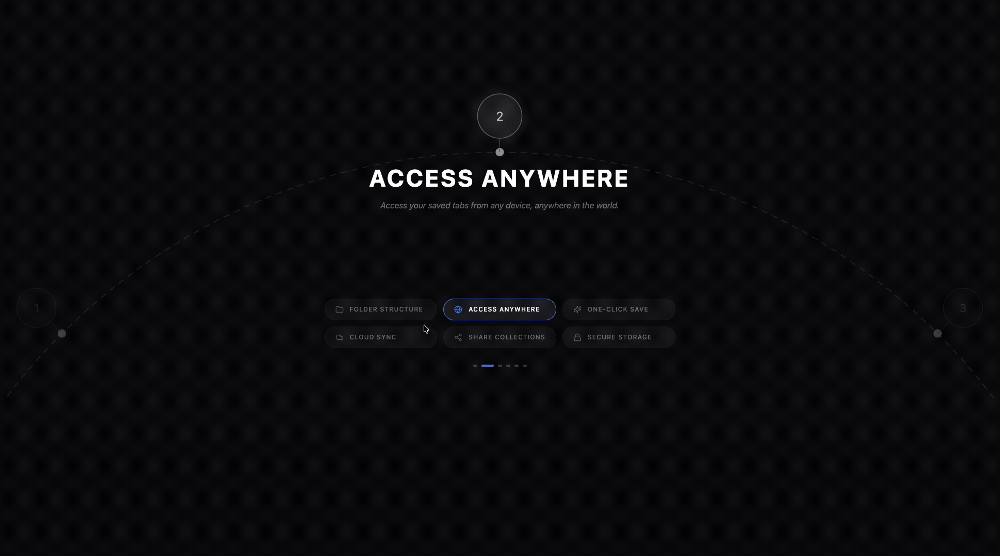

<h1 align="center">Radial Process Wheel</h1>

<p align="center">
  An interactive radial feature navigator that combines a rotating process arc with animated content transitions.
</p>

<p align="center">
  
  
  
  
</p>

<p align="center">
  <a href="#overview">Overview</a>
  ·
  <a href="#getting-started">Getting Started</a>
  ·
  <a href="#component-behavior">Component Behavior</a>
  ·
  <a href="#deployment">Deployment</a>
</p>

<br />

<p align="center">
  
</p>

## Overview

Radial Process Wheel is a focused React UI component for presenting a sequence of product capabilities or process steps. Eight SVG nodes are arranged around a large circular arc, while six feature items are rotated into an active position and displayed with animated descriptive content.

The component includes:

- A dark, minimal presentation surface
- An SVG-based dashed radial arc and numbered nodes
- Automatic feature rotation every four seconds
- Manual selection through feature buttons and pagination indicators
- Direction-aware content transitions using Framer Motion
- Active-node highlighting, connector lines, and glow effects
- Responsive three-column feature controls
- Accessible button labels and `aria-pressed` state

## Tech stack

- **React 18 + TypeScript** — component state and typed feature data
- **Vite 5** — development server and production builds
- **Framer Motion** — content enter/exit transitions
- **Lucide React** — feature icons
- **Tailwind CSS** — layout utilities
- **SVG** — radial geometry, connectors, and node rendering

## Requirements

- Node.js (an active LTS release)
- npm
- A modern browser with SVG and JavaScript support

## Getting started

### 1. Install dependencies

```bash
npm install
```

### 2. Start the development server

```bash
npm run dev
```

Vite will print the local URL in the terminal, usually `http://localhost:5173`.

### 3. Create a production build

```bash
npm run build
```

### 4. Preview the production build

```bash
npm run preview
```

## Available scripts

| Command | Description |
| --- | --- |
| `npm run dev` | Start the Vite development server |
| `npm run build` | Build the production bundle |
| `npm run preview` | Preview the production bundle locally |
| `npm run lint` | Run ESLint across JavaScript and TypeScript source files |

## Project structure

```text
.
├── public/                      # Static files served from the site root
├── src/
│   ├── components/
│   │   └── RadialProcessUI.tsx  # Arc, nodes, active content, and controls
│   ├── App.tsx                  # Component page shell
│   ├── index.css                # Tailwind imports and global styles
│   └── index.tsx                # React entry point
├── index.html                   # HTML shell and page title
├── package.json                 # Scripts and dependencies
├── tailwind.config.js           # Tailwind configuration
├── postcss.config.js            # PostCSS configuration
├── tsconfig.json                # TypeScript configuration
└── vite.config.ts               # Vite configuration
```

## Component behavior

The feature list contains six LinkVault-inspired capabilities:

1. **Folder Structure**
2. **Access Anywhere**
3. **One-Click Save**
4. **Cloud Sync**
5. **Share Collections**
6. **Secure Storage**

The UI renders eight numbered radial nodes, while the six feature controls drive the active feature state. The selected node is brought to the top through an SVG group rotation. Content transitions slide in according to the direction of selection, and the active feature automatically advances every four seconds.

## Customization

### Feature content

Edit the `features` array in [`src/components/RadialProcessUI.tsx`](src/components/RadialProcessUI.tsx) to change names, labels, descriptions, or icons. The active content and button grid are generated from this array.

### Radial geometry

Adjust `TOTAL_NODES`, `SVG_WIDTH`, `SVG_HEIGHT`, `CX`, `CY`, `RADIUS`, and node dimensions in [`src/components/RadialProcessUI.tsx`](src/components/RadialProcessUI.tsx) to change the arc proportions, node spacing, and responsive composition.

### Timing and visual design

Change the four-second interval, Framer Motion transition values, colors, and active-state styling in the same component. The page background is set in [`src/App.tsx`](src/App.tsx).

## Current integration notes

- This is a self-contained presentation component with no backend, data fetching, routing, or persistence.
- The feature content is static and currently uses LinkVault product language.
- The radial visualization intentionally renders eight nodes for the process graphic while exposing six selectable feature descriptions.
- The component has no external API or authentication requirements.

## Quality checks

```bash
npm run lint
npm run build
```

## Deployment

Radial Process Wheel is a static Vite application. Deploy the generated `dist/` directory to Vercel, Netlify, GitHub Pages, or any static web server.

| Setting | Value |
| --- | --- |
| Install command | `npm install` |
| Build command | `npm run build` |
| Output directory | `dist` |

